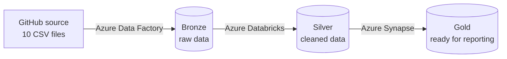

# Bronze-to-Gold Sales Lakehouse on Azure

**By Suhas Ramachandra** · [GitHub](https://github.com/rsuhas2001)

I built this project to learn how data moves through a real cloud pipeline, from raw files all the way to analytics-ready tables. It takes AdventureWorks sales data, brings it into Azure, cleans it up, and gets it ready for reporting, using the bronze → silver → gold (medallion) approach that a lot of data teams use.

## How It Works

## Tools I Used

Azure Data Factory, Azure Data Lake Storage Gen2, Azure Databricks (PySpark), and Azure Synapse Analytics (serverless SQL).

## The Numbers

- **10** source files brought in
- **1** pipeline handles all 10 files, instead of 10 separate copy steps
- **3** years of sales data (2015–2017)
- **3** layers: bronze, silver, and gold

## What I Did

### Step 1: Bring the data in (Bronze)
I used Azure Data Factory to pull 10 CSV files from GitHub into my data lake. Instead of building a separate copy step for every file, I built one pipeline that reads a small JSON list of files and loops through it. Adding a new file now just means adding one line to that list.

### Step 2: Clean it up (Silver)
In Azure Databricks, I read the raw files with PySpark and cleaned them: pulled month and year out of dates, combined customer names into one column, split product codes and names, fixed timestamps, and counted orders per day. I saved the results as Parquet files, which are faster to query. To let Databricks read and write the data lake securely, I set up a service principal with the right access.

### Step 3: Get it ready for reporting (Gold)
In Azure Synapse, I created SQL views on top of the cleaned files, so the data can be queried like regular tables without copying it into a database. I also saved the sales data as an external table in the gold layer, so it's stored and ready to use.

## What I Learned

- One well-built pipeline with parameters can replace a lot of repeated manual work.
- Small settings matter. A Lookup activity only returns the first row unless you turn that option off, which quietly breaks the loop.
- Names have to match exactly between the pipeline and the JSON list, or the run fails.
- Azure services can access each other securely without passwords, using service principals and managed identities.
- You can query files sitting in a data lake as if they were a database, which keeps storage cheap.
